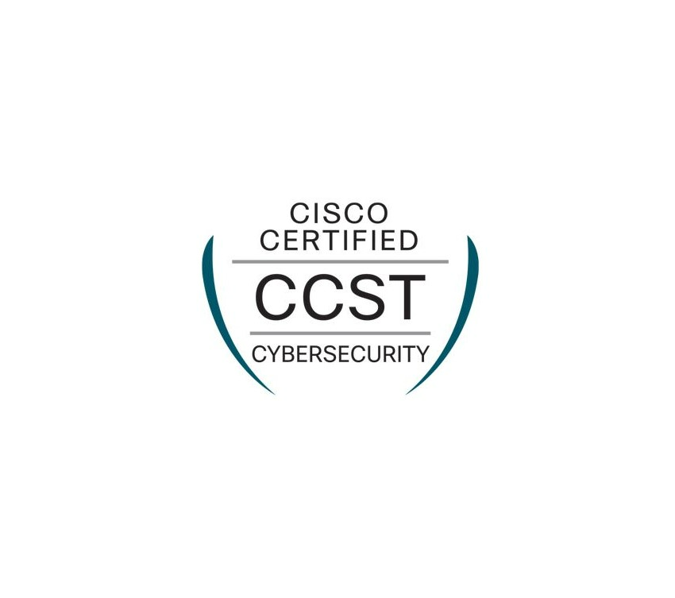

  
   
  

## <picture></picture> **About Me**

👩‍🎓 **I have two technical degrees:** one in Computer Systems, Web Applications, and Databases, and another in Maintenance of Microcomputer Systems.
 
👩‍💻 **I am a Computer Science graduate** from the National Autonomous University of Mexico (UNAM).
 
✏️ **I love mathematics,** especially algebra and calculus, and enjoy solving complex problems and puzzles.
 
💬 **Ask me about** Python, Java, C#, JavaScript, and PHP.
 
🎥 **Fun fact:** In my free time, I create animations. 

---
###  **Tech Stack & Skills**

### 💻 1. Programming & Markup Languages

  

  

### 🌐 2. Frontend Development & Styles

  

### ⚙️ 3. Backend & APIs

  

### 🗄️ 4. Databases & Storage

  
  
  

### 🛠️ 5. Version Control & DevOps

  
  

### 🔒 6. Cybersecurity & Networks

  
  
  
  
  
  

  

### 🎮 7. 3D Modeling, VR & Game Development

  

### 💻 8. Operating Systems & Environments

  

### 🎨 9. UI/UX Design & Prototyping

  
  
  

### 📝 10. Documentation & Academic Tools

  
  
  

